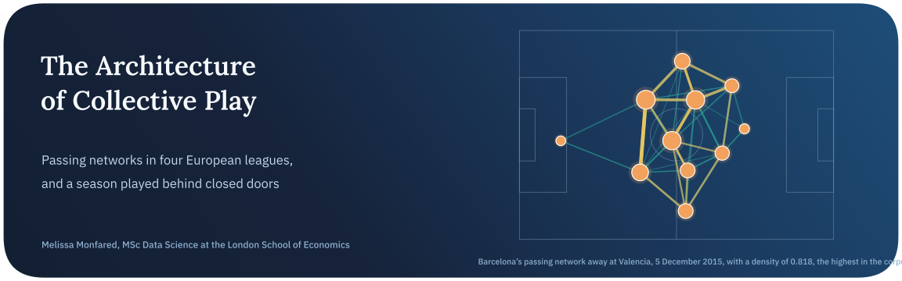
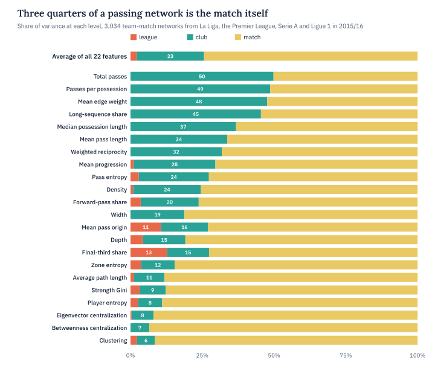
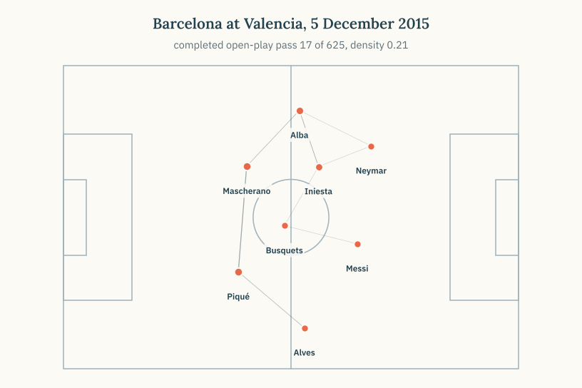
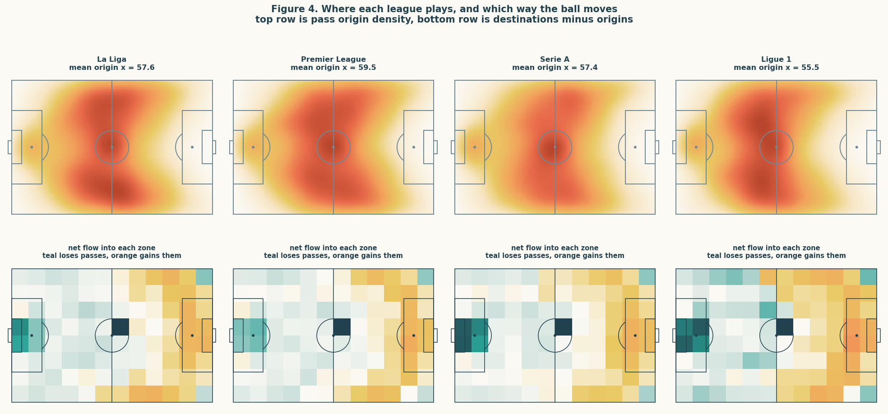
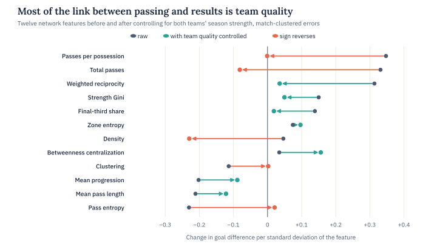
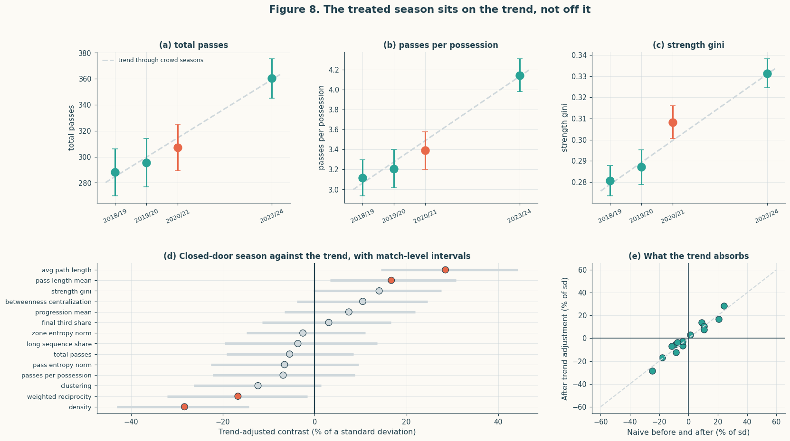

<p align="center">
  
</p>

<p align="center">
  
  
  
  
</p>

Passing networks are one of football analytics’ favourite pictures. Put the players at their average positions and join them with lines weighted by how often they passed to each other, and the result looks like a team’s identity. What the picture doesn’t show is how much the same team’s network would change a week later against a different opponent, so claims about style rarely get tested against ordinary match-to-match noise.

This project treats the passing network as a random object with a nested structure and asks where its variation actually sits. The main sample is the only complete, balanced cross-section in the StatsBomb open archive, the 2015/16 season of La Liga, the Premier League, Serie A and Ligue 1. A second sample from the FA Women’s Super League, whose 2020/21 season was played entirely behind closed doors, serves as an embedded case study of what happens when the crowd disappears.

> **In short.** Three quarters of the variation in a passing network belongs to the individual match and about a quarter to the club, leaving 2% for the league. Leagues differ in where on the pitch they play but not in how their passing is wired. Most of the apparent link between passing structure and results turns out to be team quality, and the closed-door season can’t be separated from a trend that was already under way.

## Key findings

| Finding | Evidence |
| :-- | :-- |
| A passing network is mostly about the match | Averaged over 22 features, the match holds 74.3% of the variance and the club 23.4%, leaving 2.2% for the league. Club is significant for all 22 features and league for 8 |
| Clubs differ most in volume and tempo | The club holds about half the variance in total passes (49.8%) and passes per possession (48.6%), but only 6% to 8% in clustering and centralization |
| League signatures are spatial, not topological | League explains 12.7% of final-third share and 10.6% of mean pass origin. Every one of the 9 pairwise league differences that survives Tukey’s correction is spatial, with Ligue 1 playing deepest and the Premier League highest |
| A single network barely reveals its league | A classifier reaches 0.372 balanced accuracy against a chance level of 0.25, and clustering the 80 clubs recovers the league labels at an adjusted Rand index of −0.005 |
| Players repeat their role more than teams repeat their shape | A player’s own mean explains 46.6% of the variance in their involvement share across matches |
| Results are mostly about team quality | Total passes goes from +0.33 to −0.08 per standard deviation once both teams’ strength is controlled, and 5 of 12 features reverse sign, with a median shrinkage of 71% |
| Structure describes a match but doesn’t forecast the next one | Same-match network features add 0.028 to ROC-AUC for predicting a win, while features from a club’s earlier matches make forecasting 0.013 worse |

<picture>
  <source media="(prefers-color-scheme: dark)" srcset="assets/variance-dark.svg">
  
</picture>

## Conclusion

The central result is that a passing network is mostly evidence about a match. Even for the features where the club matters most, the match still holds about half the variance, and for concentration measures like centralization and clustering the club barely registers at all. That split explains why a single network says so little about its league, and why a club’s earlier networks don’t help forecast its next result.

National leagues do differ, but in territory rather than structure. The Premier League plays highest up the pitch and Ligue 1 deepest, a gap of 5.4 percentage points in final-third share and about 3.6 yards in mean pass origin between club averages. On how the passing graph is wired, from density to reciprocity, the leagues are indistinguishable, and that holds under every alternative network construction tried.

The outcome models and the closed-door case study both show how much depends on the checks. Controlling for team quality reverses five of twelve associations with goal difference, although five features still keep an association that survives a false-discovery-rate correction. In the Women’s Super League, passing volume rose season after season across the closed-door year rather than jumping in it. With treatment assigned to one season out of four, no permutation test can reject an effect of any size, a limit the power analysis makes explicit.

## The data

All data come from StatsBomb Open Data, where every event carries a location on a 120 by 80 pitch and every pass also carries its recipient. The cross-section covers 1,517 matches between 80 clubs, giving 3,034 team-match networks, with Ligue 1 missing 3 of its 380 fixtures. The case study adds 457 Women’s Super League matches across 2018/19, 2019/20, 2020/21 and 2023/24. That makes 1,974 matches and about 7.4 million events in all.

The pipeline was checked against the historical record rather than trusted. Every goal is rebuilt from shot and own-goal events, and the resulting league tables match the official 2015/16 record exactly for nine clubs on seven quantities each, Leicester City’s 81 points included. Those checks caught failures that raised no error at all, among them two Ligue 1 clubs with zero passes from a naming mismatch and 128 matches each missing an own goal.

A network here is directed and weighted, built from completed open-play passes, with substitutes included as nodes. Every network is also rebuilt under alternative definitions to check that the results don’t depend on these choices.

<p align="center">
  
</p>

*Barcelona’s network at Valencia building itself pass by pass, the densest network in the corpus at 0.82.*

## Methods

| Question | Method | Result |
| :-- | :-- | :-- |
| Where does the variance sit? | Nested random-effects ANOVA in closed form, with Benjamini-Hochberg across 22 features | Match 74.3%, club 23.4%, league 2.2% |
| How uncertain are the shares? | Club-level bootstrap and a hierarchical Bayesian model under three priors | Club and match are pinned by the data, while the league share moves from 2.4% to 5.6% with the prior |
| Can one network name its league? | Logistic regression and random forests with folds grouped by club | 0.372 balanced accuracy at best, against 0.25 by chance |
| Which leagues differ, and on what? | Tukey’s HSD on club means | 9 of 24 comparisons survive, all of them spatial |
| Is a player’s role stable? | Between-player variance in network position for 1,362 players | 46.6% of involvement share is the player |
| Do the results depend on how the graph is built? | Every network rebuilt under three alternative definitions | The league share stays under 5% in all 12 alternatives, though betweenness centralization correlates at −0.04 with its thresholded version |
| Does structure go with results? | Five specifications per feature, from raw to club fixed effects and a Poisson model for goals | 5 of 12 features reverse sign once quality is controlled |
| Does structure forecast? | Gradient boosting and logistic regression on same-match versus earlier-match features | +0.028 AUC in the same match and −0.013 when forecasting |
| Did empty stadiums change play? | Trend-adjusted contrasts and a season-level permutation test | No test can reject with four seasons, and passing volume follows the trend |



*Where each league plays. The top row is pass origin density and the bottom row net flow between zones, with the Premier League’s mean origin highest and Ligue 1’s deepest.*

<picture>
  <source media="(prefers-color-scheme: dark)" srcset="assets/outcomes-dark.svg">
  
</picture>



*The Women’s Super League across four seasons. Passing volume and possession length climb steadily, and the closed-door season sits on that trend rather than breaking from it.*

## Limitations and next steps

The cross-section is a single season, so everything said about clubs describes those 80 clubs in 2015/16, with squad and manager bundled together. The four leagues are the ones with complete coverage in the open archive, not a sample of world football. A passing network also leaves out off-ball movement and failed passes, and it discards the order of play entirely, so two teams with identical networks may have played quite differently.

The case study has four seasons, one of them abandoned partway through, and a two-season gap, so it is a bounded description rather than a causal estimate. Sequence-aware representations of possession, and more seasons of open data across leagues, are the natural ways to push past both limits.

## Running it

The notebook reads a prepared data folder, `fb_data`, holding the StatsBomb events and the per-network feature tables as parquet files, so it runs on Kaggle with the internet switched off. The `statsbombpy` package is used to read the competitions index live when a connection is available.

```bash
pip install statsbombpy pandas numpy scipy networkx statsmodels scikit-learn pymc arviz matplotlib imageio-ffmpeg
jupyter notebook football-passing-networks-and-league-style.ipynb
```

## Repository

```text
.
├── football-passing-networks-and-league-style.ipynb   data audit, network construction, variance decomposition, outcome models and the closed-door case study
├── assets/                                             figures used in this README
└── README.md
```

## About

Made by Melissa Monfared, MSc Data Science at the London School of Economics. More projects live on [my website](https://melissamonfared.github.io). I also post notebooks on [Kaggle](https://kaggle.com/melissamonfared) and I’m on [LinkedIn](https://linkedin.com/in/melissamonfared).

Event data from StatsBomb Open Data.
